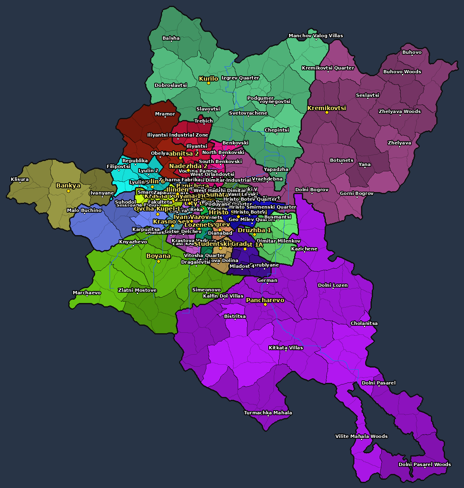

# Evil Sofia (HOI4 total-conversion mod)

The map is Sofia, Bulgaria. Each of the 24 city districts is a country, with a leader and a general.
Every country has **2 to 12 states**, so a peace deal can take part of a district instead of all of it.
The provinces follow Sofia's 310 official neighbourhoods ("kvartali"), and states and cities carry the real names
of the neighbourhoods, villages and landmarks in them.



## Install (for testing)

1. Copy this `evil-sofia` folder into `Documents/Paradox Interactive/Hearts of Iron IV/mod/`.
2. Copy `descriptor.mod` next to it, rename the copy to `evil_sofia.mod`, and add the line
   `path="mod/evil-sofia"` to it.
3. Turn the mod on in the launcher. While testing, add `-debug` to the game's launch options (Steam → Hearts of
   Iron IV → Properties → Launch options). **Without `-debug` the game never writes map errors to `error.log`**;
   it only shows "Failed to load the map". With it, the errors are logged and most of them stop being fatal.
4. Building positions in `map/buildings.txt` are rough placements; unit positions are left to the game.
   Fine-tune both in game with the `nudge` console command.

## Layout choices that keep the game happy

These follow a working 1.16 total-conversion map mod (MappaMundi) and engine rules measured in game on HOI4 1.19
by the Hoi4_world_map project (github.com/derprito64bit/Hoi4_world_map):
- The map is 5632x2048, the vanilla size: the camera limits, the map frame (vanilla ambient objects) and the
  water textures are made for it. The city is 1150 px tall in the middle; around it is the real land around
  Sofia (Vitosha, Lyulin, the Balkan foothills, Plana, the Iskar reservoir) as impassable lake provinces.
- `common/defines/zz_evil_sofia_defines.lua` sets `MAP_SCALE_PIXEL_TO_KM` to 1.5 (one pixel is really ~47 m)
  so movement takes about as long as in vanilla, and points the main-menu camera at the city.
- `map/terrain/colormap_rgb_cityemissivemask_a.dds` is neutral grey: vanilla's world colour map stretched over
  Sofia looked wrong, and grey leaves the ground textures untinted.
- Every province is at most 150 pixels across. The engine logs "TOO LARGE BOX" and misplaces unit models for
  provinces taller than about 174 px on the vanilla map.
- `map/buildings.txt` uses the HOI4 1.19 building position types, in vanilla's numbers: per state 6 arms
  factories, 6 civilian factories, 3 anti-air, and one each of air base, refinery, radar, fuel silo,
  stronghold network, nuclear reactor and rocket site; per land province a bunker, a supply node and a
  special project facility. A state without an air base, rocket site or gun emplacement position is a fatal
  map error. `airports.txt` and `rocketsites.txt` no longer exist in 1.19 and are not generated.
- `map/unitstacks.txt` gives every land province the 9 unit-counter anchors and the sea province the 13 that the
  stock file supplies (0, 1, 2, 9, 10, 21, 22, 23, 38; sea also 11, 12, 30, 31). At match start the engine looks
  these up and dereferences them unchecked; with only the victory-point anchor the game crashed 2 s after Start.
- `tutorial/tutorial.txt` is replaced by one block that names no state or province: the stock one names state 550
  and provinces 5010, 5091, 12766, and the hint loader resolves them at every match start (another crash).
- Map-shaped textures (colour map, fog of war, water colour maps, both minimap widgets) are replaced: vanilla's are
  pictures of the Earth. `cities.bmp` uses index 4 (no city group) except the house patches (15, western cities).
- Most of these engine facts come from the HOI4-AI project (github.com/noahsabaj/HOI4-AI), which read them out of
  crash dumps and verified a generated map that starts and runs a match on 1.19.
- Every strategic region passes the engine's region-centre rule (a region whose averaged box centre falls
  outside all its provinces, exactly on the middle column, crashes the game with a divide-by-zero).
- Vanilla on_actions, events and decisions are written for the world map and its countries, so they are replaced
  (`replace_path`) by `common/on_actions/evil_sofia_on_actions.txt`, which only writes checkpoints to `game.log`
  ("Evil Sofia checkpoint 1/2/3"); the `log` effect works without `-debug`. Vanilla AI strategies are kept: an
  empty AI strategy folder is the kind of missing database the HOI4 wiki's troubleshooting page warns about.
- One small sea province (a 96x96 corner of the map, its own naval strategic region) so the naval systems have
  something to work with; vanilla always has sea.
- **Every file is written with Windows (CRLF) line endings.** With plain LF line endings, HOI4 drops the
  continent column of `map/definition.csv`, every land province fails the "must belong to a continent"
  map check, and starting a game stops with *"Failed to load the map"*. `.gitattributes` keeps git from
  converting them.
- Terrain comes from real data (`tools/fetch_geodata.py`): elevation from the AWS Terrain Tiles (SRTM-based) and
  land cover from ESA WorldCover 2021. The heightmap and the normal map follow the real relief (the normal map
  exaggerates slopes 3x so hills read clearly); tree cover gives forest textures and tree models (parks
  included); high or steep ground is rock, above 2500 m snow; built-up areas are plain ground with a small patch
  of houses (city texture) around each named city. Whole built-up areas with houses made the game lag.
- Gameplay terrain per province: mountain if 35 % is mountain, plains if 30 % is built-up, forest if 50 % is tree
  cover, hills if 40 % is hilly, else plains.
- The Iskar reservoir and other big lakes inside the city are impassable lake provinces.
- Rivers (Iskar, Perlovska, Vladayska, Boyanska) follow the real valleys: the cheapest path over the elevation
  between rough waypoints. 1 px wide, 4-connected, one source each, flow-in pixel where a tributary joins.
- Characters: `common/characters/<TAG>.txt` gives every country a leader (despotism) and a corps commander;
  `common/names/evil_sofia_names.txt` gives the game Bulgarian names for the characters it generates itself.
  Leaders with their own name and portrait: Sredets Victor Kolev, Oborishte Anton Zafirov, Lozenets Georgi
  Yanchovichin, Triaditsa Alexander Dimitrov, Krasna Polyana Stefan Kartunov, Mladost Georgi Poryazov, Lyulin
  GrimBoss, Vitosha Daniel-Henry Capel. A leader gets a portrait when `tools/portraits/<TAG>.png` exists (any size;
  it is trimmed to the game's 156x210 frame);
  portraits are kept out of the repository (`.gitignore`) and only go into the packaged mod.
- The game starts on **1 January 2026**. `NGame.START_DATE` and `END_DATE` (2100) are moved in the defines file,
  otherwise the game would be past its end date at the start. On the start screen the eight countries with their
  own leaders are the featured ones, with a short description each; the other sixteen are the small flags below.
  The start screen only shows a minor country as a small flag when it has a focus tree of its own, so those
  sixteen share a small starter tree (`common/national_focus/evil_sofia_starter.txt`, 13 focuses: district hall,
  martial law, streets, workshops, a research slot, city guard, rooftop air defence and artillery; vanilla
  icons). The featured eight keep vanilla's generic tree until real focus trees are made.
- **Sredets focus tree** (`tools/focus_sredets.py`, written by `tools/build_focus.py`): the first focus is either
  "Henry's Mom Was Right" (communism) or "Order in the Centre" (the authoritarian path, one focus for now). The
  communist path: ally or destroy Anton Zafirov (with the North-South Pact if allied), the war on Daniel-Henry,
  conquering the centre, the Party on the Largo, the Red Guards of Vasil Levski Stadium, Mimas Döner for the
  workers. Daniel-Henry has the trait "Hates Communism" and is told when Sredets turns red. Icons come from the
  DuoDex hoi4GFX and Ultimate HOI4 GFX packs (cached in `tools/icons/`); the ones with people are cut out of the
  leaders' portraits by `tools/focus_icons.py` and, like the portraits, are kept out of the repository.
- Flags come from the "Flags of Sofia and her regions" sheet, one image per district in `tools/flags/<TAG>.png`;
  the build scales them to the game's three flag sizes.

## Provinces, states and names

- **Provinces** are the official neighbourhoods of Sofia (Sofproekt, 2019). A neighbourhood inside a district is a
  province, or several if it is big. Land outside every neighbourhood (fields, forest, mountain) joins the
  nearest neighbourhood along the terrain, and pieces that are too big are split along the terrain too: they
  grow outwards over a cost map (steep slopes, rivers and the edges between built-up land, forest and fields
  are expensive, plus some noise), so borders settle on ridges, rivers and street edges. No province is a
  straight-sided polygon. Sizes: about 0.8 km² in the old city, 2.5 km² in the outer housing estates and
  6 km² in the countryside, never more than 140 px across.
- **District borders** were traced by hand from a district map. Inside the city they now follow the real
  neighbourhood edges: a neighbourhood that lies 60 % or more in one traced district joins that district whole.
- **States**: about one per 3 provinces in the city and one per 4–5 in the countryside, 2 to 12 per country.
  They grow from the country's capital neighbourhood and other important, well-spread places; a state that
  grows big grows slower, so states end up compact and of similar size.
- **Names** are transliterated with the official Bulgarian system (Младост 1 → Mladost 1). The capital state
  carries the country's name; every other state is named after its main neighbourhood or village. A
  neighbourhood split between two districts gives "West Lozenets"-style names; a state with no named place is
  called after the nearest one and its land ("Bistritsa Heights", "Yana Fields", "Lozyata Woods").
- **Population** (state manpower): each state's share of its district's real population (shared out by
  built-up land), multiplied by a random number from 100 to 200 per state, so the districts can raise armies
  of a real war's size: about 186 million people in all, from 2.2 million (Bankya) to 18.6 million (Mladost).
  The multipliers come from a fixed seed, so every build gives the same numbers.
- **Victory points**: country capitals 30 (Sredets), 15 (Vazrazhdane, Oborishte) or 10; the main place of every
  other state 3; every other housing estate, quarter and village 1.
- **Localisation keys are unique to the mod** (`EVIL_SOFIA_STATE_<id>`, `EVIL_SOFIA_REGION_<id>`) and the file is
  in `localisation/english/replace/`. With vanilla-style keys (`STATE_9`, `STRATEGICREGION_3`) vanilla's names
  won, which is why states showed names such as "Bohemia" and "Flanders".
- **Strategic regions** (air zones, weather): Old Town, Southern, Western, Northern and Eastern Quarters,
  Vitosha, Bankya Hills, Vrabnitsa Plain, Novi Iskar, Kremikovtsi, Pancharevo, Upper Iskar, plus the sea.
- The Kremikovtsi steelworks: steel and three military factories in the Kremikovtsi state with the most
  industrial land.
- The impassable land around the city is cut into lake provinces the same way, over the real terrain.

## How the map is made

Real geography: run `python3 tools/fetch_geodata.py` once. It downloads about 175 MB into `tools/geodata/cache/`
and writes `tools/geodata/sofia_geodata.npz` and `tools/geodata/kvartali.geojson` (not committed). Data:
ESA WorldCover 2021, CC BY 4.0 (© ESA WorldCover project, contains modified Copernicus Sentinel data 2021);
AWS Terrain Tiles (Mapzen, SRTM and other public sources); neighbourhood boundaries of Sofia Municipality
(Sofproekt, 1 January 2019, file `kvartali_26_sofpr_20190101.geojson`) as published in
github.com/bbaid/services-access-sofia. The mod contains only map data derived from them.

`tools/districts_mask.png` is the source for the districts. It is grayscale, and each pixel's value is the district number (1–24); 0 means outside the city.
`tools/build_map.py` reads it and writes every map, state, country and localisation file:

```bash
pip install numpy pillow scipy tifffile
python3 tools/fetch_geodata.py
python3 tools/build_map.py
```

If a border is wrong, paint the mask with the correct value using any editor that keeps grayscale values exactly
(GIMP, Paint.NET; no anti-aliasing). Then run the script again.

| ID | Tag | District | ID | Tag | District |
|---|---|---|---|---|---|
| 1 | SRD | Sredets | 13 | NAD | Nadezhda |
| 2 | VAZ | Vazrazhdane | 14 | ISK | Iskar |
| 3 | OBR | Oborishte | 15 | MLA | Mladost |
| 4 | KRS | Krasno Selo | 16 | STU | Studentski |
| 5 | SRK | Serdika | 17 | LYU | Lyulin |
| 6 | POD | Poduyane | 18 | KRE | Kremikovtsi |
| 7 | SLA | Slatina | 19 | VIT | Vitosha |
| 8 | IZG | Izgrev | 20 | OVK | Ovcha Kupel |
| 9 | LOZ | Lozenets | 21 | VRB | Vrabnitsa |
| 10 | TRD | Triaditsa | 22 | NIS | Novi Iskar |
| 11 | KRP | Krasna Polyana | 23 | PNC | Pancharevo |
| 12 | ILN | Ilinden | 24 | BNK | Bankya |

State files are `history/states/<id>-<TAG>_<name>.txt`, numbered district by district with each country's
capital state first. The provinces outside the city are impassable lakes ("The Void").
Sofia has no sea, so there are no navies.

## Known gaps

- Armies are minimal: every district starts with basic infantry, support, artillery and train technology,
  a "City Guard" template (4 infantry battalions), 1-3 divisions in its capital (one per 40,000 people, rounded
  up) and 500 infantry equipment in stock.
- Vanilla focus trees and events still refer to vanilla countries and states; they never fire for the districts.
- `supported_version` is `1.*`, so the launcher accepts any 1.x game version.
