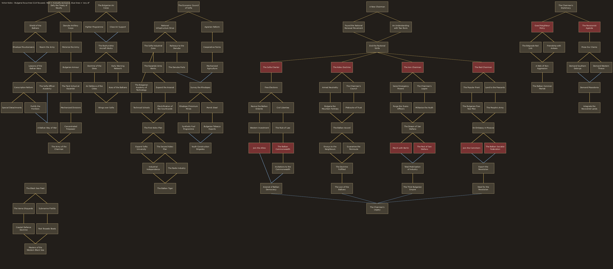

# Victor Kolev: Chairman of Bulgaria (HOI4 mod)

You play as Victor Kolev, the young Chairman of the Council of Ministers of Bulgaria in 1936. He replaces the vanilla Bulgarian leader at game start and gets his own focus tree of 114 focuses.

## Install
1. Copy `mod/victor_kolev/` **and** `mod/victor_kolev.mod` into
   `Documents/Paradox Interactive/Hearts of Iron IV/mod/`.
2. Enable "Victor Kolev: Chairman of Bulgaria" in the launcher and start a game as Bulgaria (1936 start).

## What's in it
- **Leader**: Victor Kolev (custom portrait). He has a leader role for each ideology, so he stays in charge whichever path you take. Custom traits: *The Young Chairman*, *Man of the People*, *Iron Will* and *Red Reformer*.
- **Starting problems**: *Factional Strife*, *Shadow of Neuilly* and *Agrarian Economy*. Each one is removed by a focus.
- **Politics (41 focuses)**: Four mutually exclusive paths:
  - *Sofia Charter*: democratic. Join the Allies or found a Balkan Commonwealth.
  - *Kolev Doctrine*: armed neutrality. Lead your own Balkan Accord and guarantee your neighbours.
  - *Iron Chairman*: fascist. March with Berlin or found the Pact of San Stefano.
  - *Red Chairman*: communist. Join the Comintern or found a Balkan Socialist Federation.
  - All four paths lead to *The Chairman's Legacy*.
- **Economy (25)**: Factories, two research slots, chromium, steel and oil, and tobacco exports.
- **Army (17), Air (9), Navy (6)**: Mostly research bonuses and experience. Only a few direct power boosts.
- **Foreign policy (12)**: Choose between Good Neighbour (peaceful) and Revisionist. The Revisionist branch sends demands to Romania, Greece and Yugoslavia by event. The target can cede the claimed land or refuse, and a refusal gives Bulgaria a wargoal.

## Balance notes
- The tree can give at most about 12 civilian factories, 11 military factories and 2 research slots. Bulgaria can't finish every branch before about 1948, so expect around 60 completed focuses in a game.
- New cores only apply to land you already hold, and the integration focus requires that you own the territory first.

## Rebuilding
`python3 tools/build_mod.py` regenerates every script and the localisation from one data file, and checks the tree for broken prerequisites, position clashes, missing ideas and fewer than 100 focuses. `python3 tools/make_portrait.py <image> mod/victor_kolev/gfx/leaders/BUL` rebuilds the portraits. `python3 tools/render_tree.py focus_tree_preview.png` redraws the preview.

## Known limitations (untested in-game)
- Focus, idea and event icons use vanilla GFX names. If a name doesn't match your game version, that icon shows up blank. Nothing crashes.
- Territorial claims select states by geography, not state ID: the Romanian coastal state bordering Bulgaria, the Greek states bordering Bulgaria, and the Yugoslav state bordering both Bulgaria and Greece.
