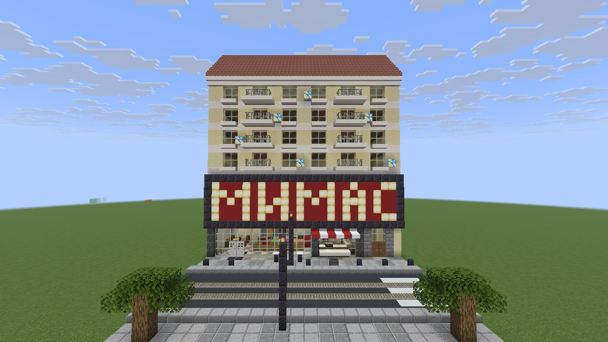
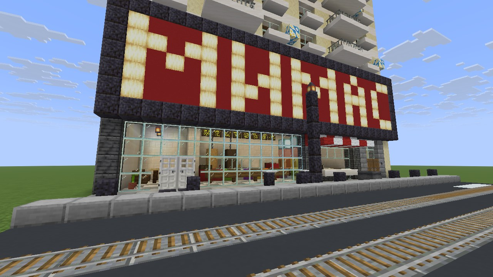
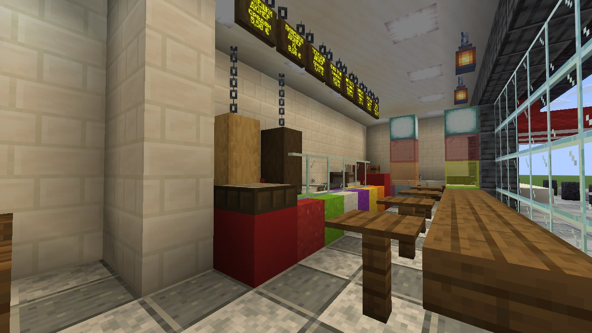
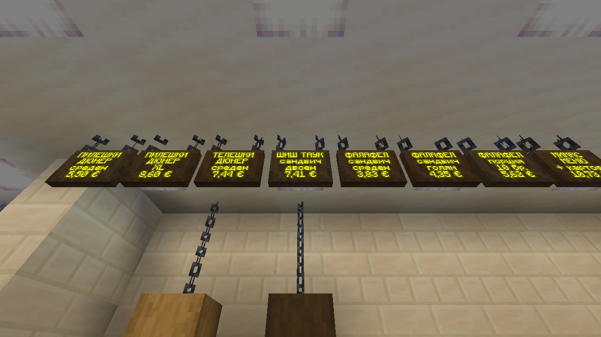
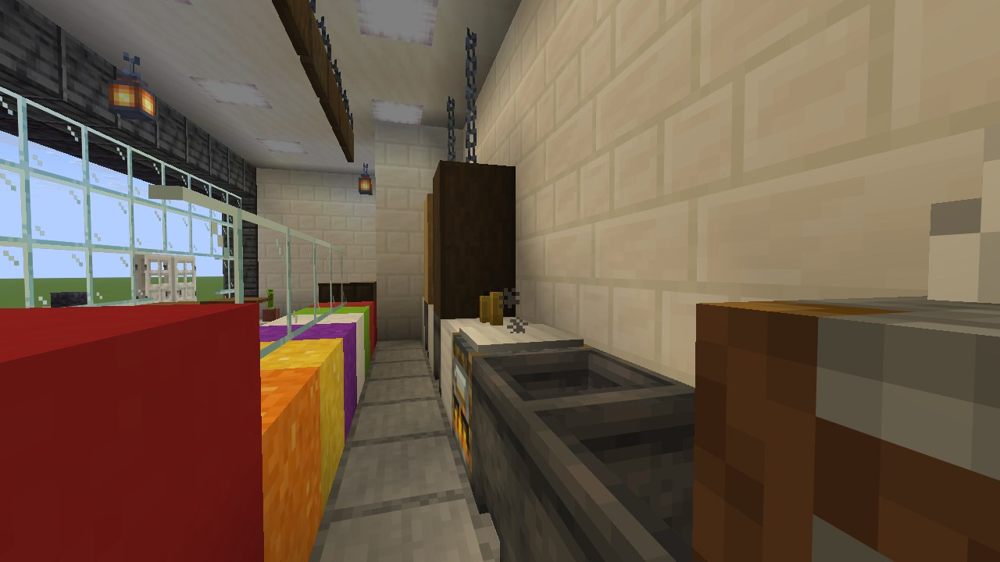
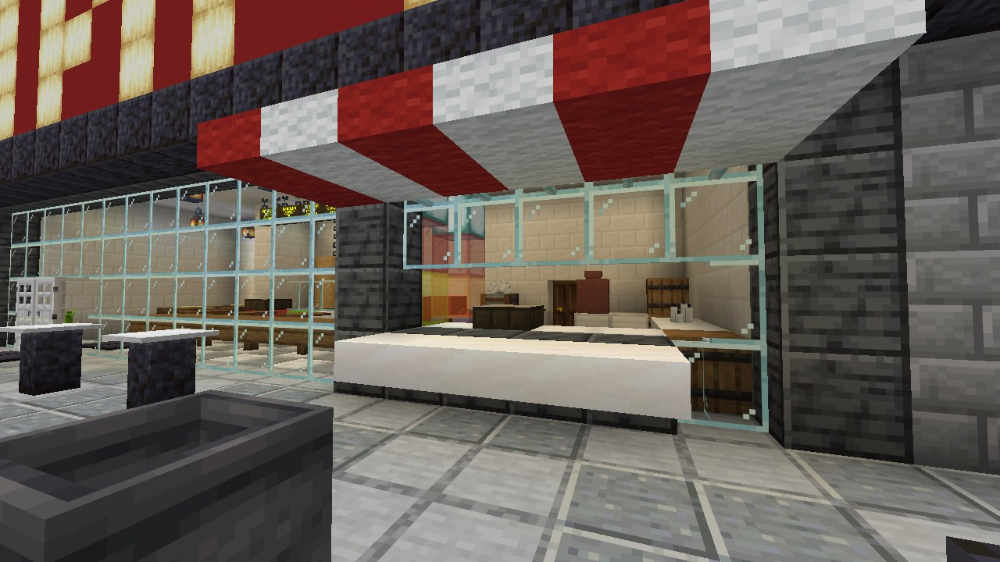
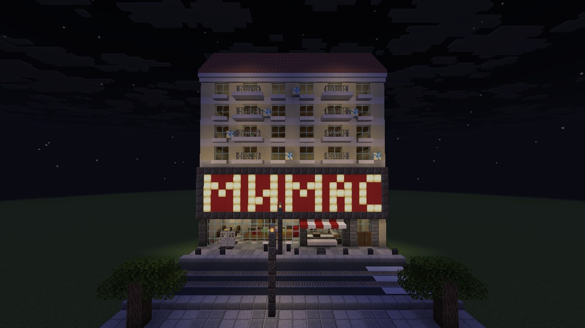
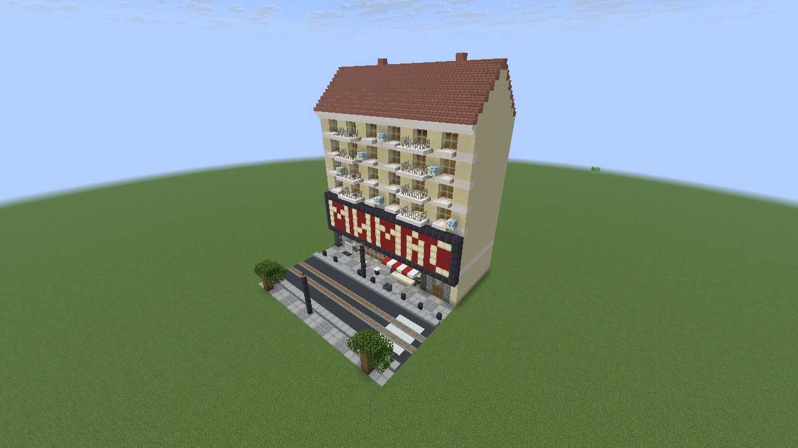
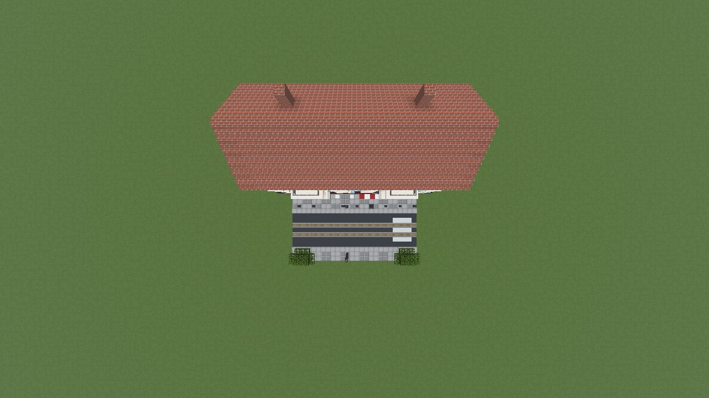

# Mimas (Sofia) — Minecraft Java 26.3

A block-by-block Minecraft version of **Mimas**, the döner / falafel takeaway at Graf Ignatiev / Vasil Levski in
central Sofia. No photos were used, so this is a typical Sofia city-centre takeaway rather than a replica of the
real façade: the ground floor of an older 5-storey residential block, a lit **МИМАС** sign band, and a street
with tram tracks outside.

| File | For |
|---|---|
| [`mimas-datapack.zip`](mimas-datapack.zip) | Vanilla data pack: `/function mimas:build`, undo with `/function mimas:clear` |
| [`mimas.litematic`](mimas.litematic) | Litematica |
| [`mimas.schem`](mimas.schem) | WorldEdit / FAWE / Axiom (Sponge schematic v2) |

## Install (Java 26.3, Creative, cheats on)
1. Put `mimas-datapack.zip` in `<world>/datapacks/` (or *Create World → Data Packs*, drag it in), then `/reload`.
2. Stand on flat, dry ground where the **sidewalk in front of the shop** should be.
3. `/function mimas:build`. You're turned to face the shop.
4. `/function mimas:clear` puts back exactly what was there before (same session, see limits).

## Where it appears
- You are the origin, standing on the sidewalk. The shop is north of you, the road south.
- Footprint **26 × 26, 34 high**: x from −10 to +15, z from −13 to +12, y from −2 (foundation) to +31.
  Everything in that box is replaced.
- Shop: 21 × 11 outside, 19 × 9 inside, ceiling 5 blocks. Flats' entrance bay on the east end.
- 6,290 blocks, 83 block types. Placed by about 660 commands; no `/fill` is over 32,768 blocks.

## What's in it
- **Front:** full-width glass shop front. Double iron doors open by themselves via pressure plates on both sides.
  Street-facing takeaway hatch with a ledge and a red/white sloped awning (26.3 wool stairs and slabs).
  Lit МИМАС sign band across the frontage.
- **Inside:**
  - Service counter with a glass sneeze guard over a display (tomato, lettuce, cabbage, red cabbage, corn,
    carrot), a till and a tray stack.
  - Two vertical döner spits, chicken and beef, with glowing magma grill panels behind them.
  - Flat grill, two fryer vats, prep counter with slicer and cutting board, sauce bottles.
  - Two drinks fridges with a staff gate between them.
  - Menu board of 8 waxed hanging signs above the counter, Cyrillic, glowing text, € prices.
  - Window bar with 4 stools, 2 small tables with chairs, warm froglight and lantern lighting.
  - Back kitchen through a staff door: sinks, fridge, freezer, oven, smoker, dry store, bin.
- **Street:** tiled sidewalk, curb, asphalt road with two tram tracks, zebra crossing, two lamp posts, a bin,
  Sofia-style bollards, two standing tables, two young lindens and the far sidewalk.
- **Upper floors** (façade only, hollow behind): cream plaster, 6 windows per floor, small balconies with
  railings and flower pots, AC units, cornice, tiled pitched roof, chimneys. Hidden light blocks keep mobs from
  spawning in the hollow floors.

## Decisions you may want to change
- **Width:** the shop is 21 wide, not ~12. Five readable block letters need 24 blocks, so the sign spans the
  whole 26-block building. Everything comes from one script, so a narrower layout is a quick change.
- **Sign text:** МИМАС in Cyrillic, following the "Bulgarian" language setting. Latin MIMAS is a one-line change
  (`SIGN_WORD` in `tools/design.py`).
- **Menu prices** (€) are approximate. They come from delivery-app listings for Mimas, bul. Vasil Levski 68
  (Wolt, Takeaway.com, Glovo, 2026), which disagree with each other. Check them against the counter.

## How it was verified
Everything is in [`ci-results/`](ci-results/), produced by [`.github/workflows/mimas.yml`](../.github/workflows/mimas.yml)
on vanilla **26.3** (data pack format 121.0, DataVersion 5023):
- **Block IDs and states:** every block state the pack uses is checked against the `blocks.json` report the
  26.3 server itself generates. Result: PASS.
- **Functions:** load with zero errors on a dedicated 26.3 server.
- **Build:** drops no items. The sign NBT reads back with the Cyrillic text and € prices.
- **World diff:** block-by-block comparison of the built world against the model: pending (CI run 3 in progress).
- **Rebuild:** running `mimas:build` again over an existing build gives an identical result.
- **Undo:** `mimas:clear` restores the original terrain with 0 differences over 24,336 positions.
- **Model checks:** no floating blocks. Every area is walkable with 2-block headroom: shop, counter, nook,
  staff side, back kitchen, outside hatch, flats' entrance, far sidewalk.
- **Screenshots:** taken by the real 26.3 client. It fell back from OpenGL to its Vulkan backend on a
  software (llvmpipe) GPU.
- **Schematics:** read back by independent code, 0 mismatches over all 22,984 cells.

## Limits
- `mimas:clear` keeps its backup in memory. After the world or server restarts it can't restore the original
  terrain. Instead it removes the build and levels the box to grass.
- Water next to the box can flow into it when the area is cleared. Build on dry land.
- The schematic files were not tested inside Litematica or WorldEdit. I don't know if those mods have 26.3
  builds yet.

## Screenshots (real 26.3 client)
| | |
|---|---|
|  |  |
|  |  |
|  |  |
|  |  |

Layout previews from the generator: [front](previews/front.png), [isometric](previews/iso.png),
[top](previews/top.png), [floor plan](previews/plan.png), [cutaway](previews/cutaway.png).

## Rebuild from source
`python3 mimas/tools/build.py` regenerates the data pack, checks and previews.
`python3 mimas/tools/export_schematics.py` regenerates the schematics (needs `pip install nbtlib`).
The design itself is in `tools/design.py`.
